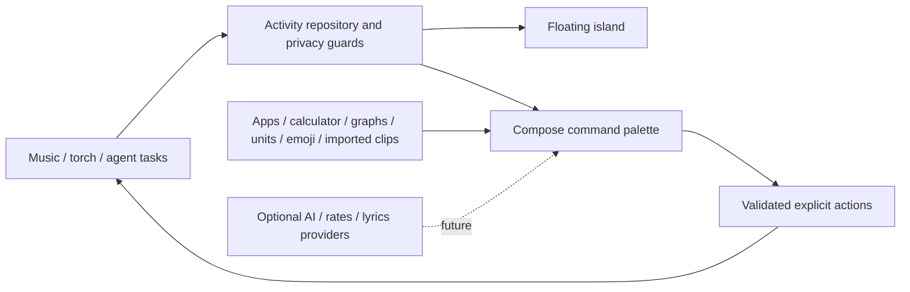

# Android Island

**An activity island and a fast command palette for Android. Built with Kotlin.**

Implementation kickoff · 17 October 2026

One app, two connected surfaces: a compact island for music, AI-agent task progress and flashlight activity, and a Raycast-inspired command palette for apps, calculations, graphs, conversions, clipboard, emoji and AI. The user's [nine-panel reference is fully mapped](docs/product/raycast-feature-map.md) into requirements and staged work.

The first development slice lives in `app` (Android/Compose and platform adapters) and `core/domain` (pure Kotlin). Live AI providers, rate feeds, lyrics and external agent connectors are still integration work. See [implementation status](docs/implementation/status.md) for verified behavior and remaining gaps. This is a development build, not a release-ready product.

## Start here

| Need | Document |
| --- | --- |
| Every requested reference feature | [Screenshot feature map](docs/product/raycast-feature-map.md) |
| Current implementation and build evidence | [Implementation status](docs/implementation/status.md) |
| Build, run and test | [Android development guide](docs/implementation/development.md) |
| Test on laptop and phone | [Step-by-step testing guide](docs/implementation/testing.md) |
| Product scope and acceptance | [Requirements](docs/product/requirements.md) |
| Full system design | [Architecture](docs/system-architecture/README.md) |
| Coding-agent instructions | [AGENTS.md](AGENTS.md) and [role handbook](docs/agents/README.md) |
| Planned work and dependencies | [Roadmap](docs/planning/roadmap.md), [backlog](docs/planning/backlog.json) |
| REA installation approval | [Separate pending setup plan](docs/tooling/rea-setup-plan.md) |
| All documentation | [Documentation map](docs/README.md) |

## Two surfaces, one system



## Development

Use JDK 17 and Android SDK 36. Exact versions are pinned in [the version catalog](gradle/libs.versions.toml) and the checksum-verified Gradle wrapper. Default namespace `dev.androidisland` is provisional.

```sh
./gradlew :core:domain:test :app:assembleDebug :app:lintDebug
make docs-check
```

On this machine, a project-local toolchain is configured in ignored `.local/build-env.sh`; source it before Gradle. Other machines should configure their own SDK path in ignored `local.properties`. See the development guide for install and manual checks.

## Current boundaries

Android controls overlay placement and background execution. The overlay is explicitly started/stopped, hidden on lock and in landscape, and uses a foreground service whose distribution eligibility remains to be reviewed. No accessibility workaround or root is used.

The first build has no network permission or model credentials. Clipboard imports are explicit, foreground-only and memory-only. Notification content is not ingested yet; listener authorization currently enables media sessions. The agent preview is labeled simulation. REA remains a separate developer tool awaiting the previously requested setup approval.
