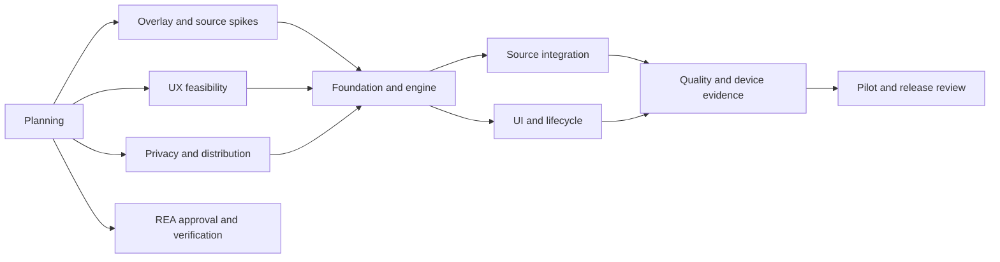

# Delivery roadmap

Status: implementation kickoff authorized; release gates remain open · Owner: Delivery

Dates and effort estimates follow pilot selection and feasibility results. Dependencies and task status live in [backlog.json](backlog.json).

| Milestone | Tasks | Deliverable | Exit gate |
| --- | --- | --- | --- |
| P0 — Planning foundation | PLAN-000 | Requirements, architecture, roles, docs checks, REA review packet | Documents linked and checks pass; proposal status explicit |
| M0 — Feasibility | PLAN-001–PLAN-004 | Device experiments, interaction review, privacy/distribution assessment | Public APIs and service approach meet required use case; ADR decisions recorded |
| M1 — Foundations | PLAN-005 | Kotlin scaffold, pure engine, dependency boundaries, synthetic fixtures | Domain invariants pass; toolchain versions pinned |
| M2 — MVP integration | PLAN-006, PLAN-007 | Sources, renderer, onboarding, controls and lifecycle | FR-01–FR-09 demonstrated on pilot devices |
| M3 — Quality | PLAN-008 | Accessibility, resource profiling, security and compatibility evidence | NFR targets and FR-10 pass or explicit scope revision |
| M4 — Pilot/release readiness | PLAN-009 | Pilot feedback, release checklist, disclosures and signing plan | Owner accepts pilot and external distribution requirements are met |
| K0 — Product expansion and first vertical slice | PLAN-011, PLAN-012 | Full screenshot inventory and buildable Kotlin development app | Source/build checks; does not close physical-device gates |
| K1 — Complete integrations | PLAN-013–PLAN-017 | Real agent execution, provider features, hardware validation and launcher polish | Feature-specific acceptance evidence |
| T0 — Optional developer tooling | PLAN-010 | Approved REA setup and verified connection | Scoped diagnostics and live MCP check pass; optional providers reported separately |

## Critical path

REA setup does not block architecture work or app development. APK/native analysis providers are not included in T0; a specific authorized research task must justify them.

## Definition of ready

A task needs an owner role, scope, dependencies, affected requirements/ADRs, concrete acceptance criteria, and an evidence plan. A high-risk platform task begins with a question and experiment, not a production commitment.

## Definition of done

All task criteria have evidence; affected docs are updated; appropriate checks pass; residual risks and reviewer are recorded. Implementation completion does not automatically establish release readiness or store acceptance.

## Implementation kickoff update

The user authorized Kotlin implementation and the two-surface product on 2026-10-17. PLAN-012 creates a development vertical slice while M0 is still open. This explicitly changes the former sequence that blocked any scaffold on all M0 experiments. Production hardening (PLAN-005) and release still depend on those results. [ADR-005](../decisions/ADR-005-command-palette-and-providers.md) records the expanded direction.
