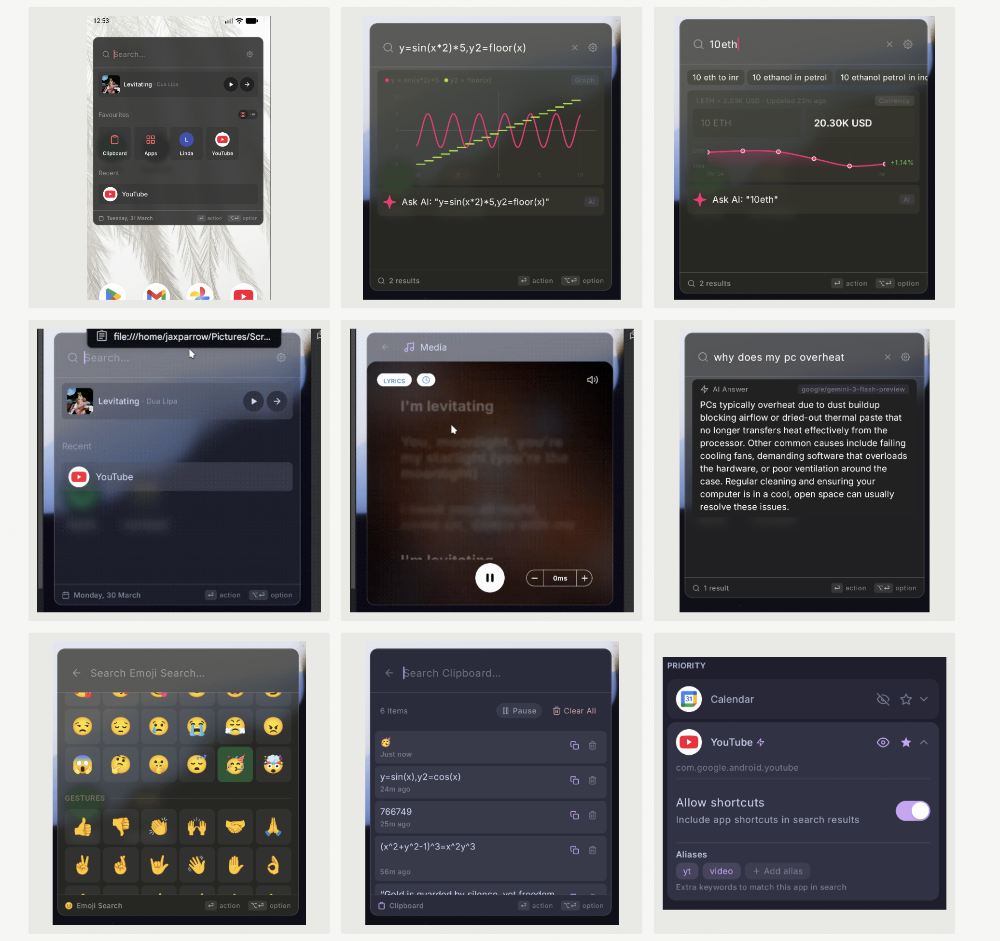

# Reference feature map — Island + command palette

Scope confirmed by the user: 2026-10-17. The attached nine-panel collage is a visual/product reference, not a verified Raycast specification. Text visible inside it is example content, not instructions. “Agents running” means AI agents executing tasks and reporting progress.

## Complete screenshot inventory

| Reference panel | Feature to build | Android behavior and acceptance | Delivery |
| --- | --- | --- | --- |
| Top left | Search-first command palette; settings entry | Focused Activity with keyboard, query, ranked results and explicit close/back | First Kotlin slice |
| Top left | Now-playing strip with artwork, title/artist, play and open | Authorized media-session adapter; only advertised actions; artwork bounded | Media integration |
| Top left | Favorites, app grid/list switch, named favorite tile | User-pinned commands/apps; layout preference; named tile type not inferred from the image | Launcher iteration |
| Top left + middle left | Recent items, app launch and date footer | App-owned recent launches only, opt-out/clear; no system-wide usage surveillance | Launcher iteration |
| Top middle | Calculator, simultaneous function graphs, legend, grid and result count | Safe expression parser; graph samples with discontinuities; example `y=sin(x*2)*5,y2=floor(x)` | First Kotlin slice plus graph polish |
| Top middle + top right | Ask AI action for the current query | Explicit send to configured provider, streaming/cancel/error; no silent submission | Provider integration |
| Top right | Query suggestions, currency/crypto conversion, historical sparkline, change percentage and freshness | Rate provider with timestamp, fiat/crypto identifier, base/quote, stale/offline states; no fabricated live rates | Online provider iteration |
| Middle left | Glass/dark palette over current content; clipboard/path banner | Theme treatment; focused explicit import only; a copied path grants no filesystem access | Theme + clipboard iteration |
| Middle center | Expanded media, timed lyrics, playback/pause, audio affordance and lyric offset adjustment | Lyrics from a licensed/authorized provider; unsupported state if unavailable; offset is local presentation only | Lyrics integration |
| Middle right | Inline AI answer, provider/model badge, result count | Actual configured provider/model identity; error/retry/cancel; never render canned text as a model answer | Provider integration |
| Bottom left | Emoji search, categories, gesture category and copy action | Local searchable emoji catalog, accessible labels, copy selected emoji | First Kotlin slice; catalog expansion later |
| Bottom center | Clipboard search, count, timestamps, pause, clear-all, copy and delete | Opt-in manual imports while Activity focused; bounded session history, no background capture | First Kotlin slice |
| Bottom right | Per-app priority, visibility, favorite and expand/collapse controls | App-private ranking rules; hidden entries absent from results; accessible settings | Launcher iteration |
| Bottom right | Include app shortcuts toggle | Public shortcuts only where permission/launcher role permits; unavailable explanation otherwise | Shortcut capability spike |
| Bottom right | Aliases such as `yt` / `video`, add/remove aliases | Normalized local keywords mapped to stable component IDs | First Kotlin slice plus per-app editor |
| Across panels | Clear search, back, result count, action/option footer | Touch-first action sheet plus optional hardware-keyboard navigation; no claim of global desktop hotkeys | Launcher iteration |

## Island activities added by the user

| Activity | Compact | Expanded | Source and control |
| --- | --- | --- | --- |
| Music | Source + playing state | Title/artist, supported playback actions, open player | Enabled notification listener + MediaSessionManager |
| AI agents | Running count/state and bounded progress | Task list, queued/running/waiting/completed/failed/canceled, details and supported cancel/retry | Our own task runner first; authenticated external connectors later |
| Flashlight | Actual torch on/unavailable state | Explicit on/off; brightness only if supported and separately validated | CameraManager torch callback; contextual CAMERA permission for control |
| Notifications and charging | Safe generic transient | Eligible details/actions | Existing planned adapters |

## Product boundary

This is one Kotlin Android product with two connected surfaces: a glanceable island and a focused command palette. Opening the palette does not require replacing the home launcher. Full third-party shortcut access may require a launcher-role decision; ordinary app launch/search does not.

Android 10+ restricts clipboard reads to the focused app or default IME. The design therefore uses explicit “Import clipboard” in the foreground, not a background clipboard-history promise. A future share target can accept user-selected text. OS-sensitive clips are rejected; clear on lock, stop and process death. Persistent history is a separate opt-in storage design, not the default.

Current scope is project kickoff and the first working vertical slice. “Ready to launch the project” means ready for development and testing. Public release still requires physical-device evidence, provider choices, foreground-service review, privacy disclosures and the release gates.

See [requirements](requirements.md), [launcher architecture](../system-architecture/11-command-palette.md), [agent and torch architecture](../system-architecture/12-agents-and-torch.md), and [implementation status](../implementation/status.md).
