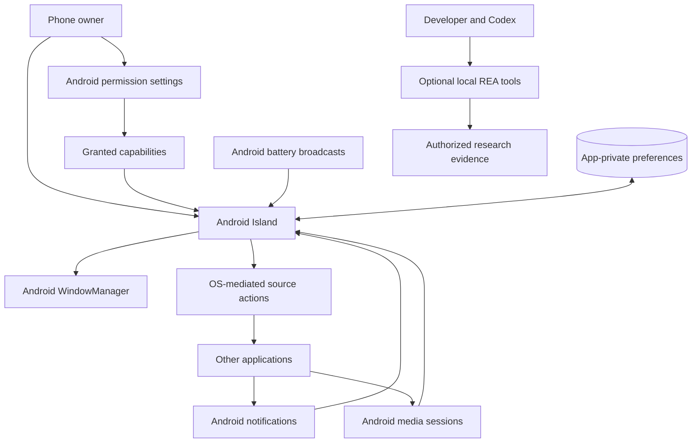

# 01 — Context and boundaries

Status: proposed · Owner: Architecture

## System context

REA belongs to the development environment. The product neither embeds REA nor depends on it at runtime. Research evidence is reviewed before becoming a requirement; it is not a license to replicate private behavior or bypass platform limitations.

## Containers and trust boundaries

| Container | Responsibility | Trust |
| --- | --- | --- |
| Main Activity | Onboarding, settings, demo, diagnostics | User-controlled configuration; validate all values |
| Notification listener | Receives permitted notification changes | Source payloads are untrusted and may be missing or redacted |
| Overlay host service | Maintains user-requested foreground session and window | Subject to OS lifetime and permission restrictions |
| Domain engine | Serial state reducer, arbitration, expiry | Pure logic; cannot invoke Android APIs |
| Local preferences | Stores settings, allowlist, schema version | App-private, but not a secret vault |
| Android OS | Permissions, windows, source dispatch, scheduling | Authority for actual capabilities |

These are logical components in one application process, not independent network services. Use ordinary in-process interfaces rather than Binder IPC between our own components unless measurement later justifies process isolation.

## System boundary decisions

- The current development slice has no HTTP APIs or backend. Requested AI/rates/lyrics features use optional providers under [ADR-005](../decisions/ADR-005-command-palette-and-providers.md); notification data never flows into them implicitly.
- No continuous polling of foreground apps. Excluding overlays by currently foreground package is not promised because it would require a separate capability decision.
- No attempt to replace OS notifications. The original remains the authoritative source of activity state.
- No interpretation of arbitrary notification text as a verified timer, trip, call, or progress protocol.
- Availability means graceful recovery with clear state, not guaranteed persistence through force-stop or OEM intervention.

Scaling is per-device event volume, animation cost, and memory pressure. Fleet scale is handled by release testing and compatibility records, not server capacity.
