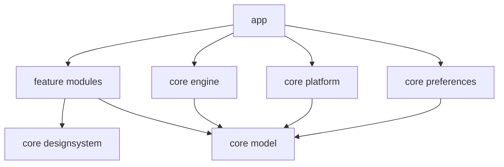

# 03 — Components and module boundaries

Status: proposed · Owner: Architecture

## Proposed source layout

The current kickoff implements `app` and `core/domain`. The more granular layout below is a target decomposition as integrations grow; see [implementation status](../implementation/status.md).

```text
app/                     Composition root, Activity, service declarations
core/model/              Immutable IDs, payloads, capability and state models
core/engine/             Pure reducer, selection, TTL and suppression logic
core/preferences/        DataStore schema, migrations, settings repository
core/platform/           Notification, media, battery, window and lifecycle adapters
core/designsystem/       Compose tokens and accessible shared components
feature/onboarding/      Demo and permission education
feature/settings/        Source choices, appearance and diagnostics
feature/island/          Rendering and user-intent presentation
benchmark/               Macrobenchmark and profiling scenarios
test-fixtures/           Synthetic source app and event sequences
```

Proposed libraries: Kotlin coroutines/Flow, Compose and Material components, DataStore, AndroidX lifecycle/test/benchmark tooling, and Hilt for Android entry-point composition if the initial spike supports it. Pin compatible stable versions together at scaffold time. Domain tests should not need Android or dependency injection.

## Allowed dependencies



`core:model` defines ports used by the composition root: event source, preference stream, renderer, action dispatcher, clock, and diagnostics sink. The root wires platform sources to the engine and engine output to presentation. Platform adapters never call Compose directly. Features do not reach into the listener or service to read mutable state. No feature-to-feature dependencies; navigate through root-owned contracts.

## Component responsibilities

| Component | Owns | Must not own |
| --- | --- | --- |
| CapabilityRepository | Observed permissions, screen/lock state, listener connection | Assumptions based on previous grants |
| NotificationAdapter | Minimal normalized events, removal and ranking changes | Display arbitration or text persistence |
| MediaAdapter | Session callbacks and supported actions | Invented controls or private APIs |
| BatteryAdapter | State transitions while enabled | A polling loop |
| IslandEngine | Eligible candidates, selected item, lifecycle-independent state | Android Context, bitmaps, PendingIntent |
| OverlayWindowController | Attach/update/detach, geometry and view lifecycle | Business priority or permission prompting |
| IslandPresenter | Render model and user intents | Source mutation without dispatcher validation |
| ActionDispatcher | Resolve current ephemeral action handle and dispatch once | Arbitrary intents reconstructed from text |
| PreferencesRepository | Validated durable configuration | Notification bodies or session tokens |

## Concurrency and resource ownership

Copy small required fields from Android callbacks and return promptly. Use a serialized coroutine actor for domain transitions; event sources submit normalized data without blocking the main thread. Artwork decoding happens on a bounded background dispatcher. Window operations and Compose state application run on the main thread. The service owns a supervisor scope; each adapter has a child job with deterministic cancellation.

The initial window uses native Views to validate overlay lifetime. Any future Compose-in-service renderer must explicitly create and destroy its required lifecycle/view-model/saved-state owners. Detach disposes the composition and clears references. A setup spike must prove no Activity or bitmap is retained after repeated start/stop cycles.

One renderer and one overlay window maximum. Immutable render state is delivered via `StateFlow`; identical states do not trigger relayout. Dependency boundaries become build checks when actual modules exist.
