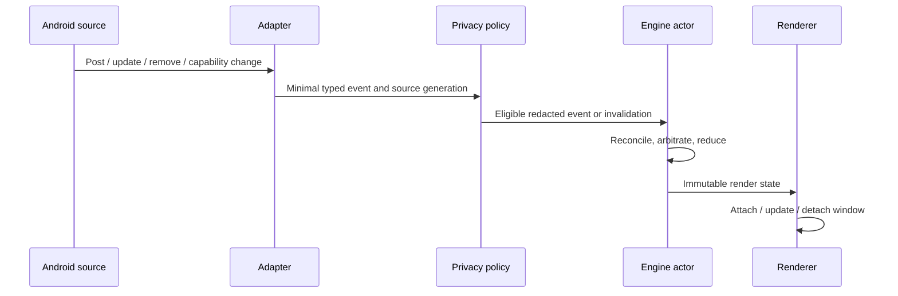
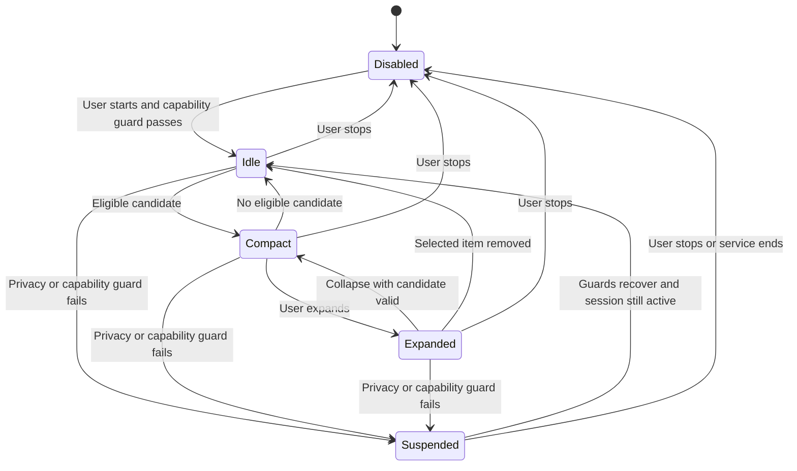

# 04 — Event pipeline and state machine

Status: proposed · Owner: Domain Engine

## Pipeline

Filter excluded packages, our own service notification, unsupported profiles, and group summaries before admission. Bound all strings, action lists, and artwork requests. An app is excluded until the user selects it; discover candidate sources from permitted notifications and launchable-app queries, without broad package visibility.

## Deterministic arbitration

1. Privacy and capability guards override every candidate.
2. Keep a valid user-expanded item selected until collapse or invalidation.
3. Otherwise show a newly admitted transient for its display interval, ordered by allowed ranking class and monotonic arrival sequence.
4. Return to the most recently user-selected active playing media session; otherwise select the most recently updated playing session.
5. With no eligible candidate, detach the window.

Proposed defaults: transient display 5 seconds; maximum transient freshness 30 seconds from receipt; paused media expires after 30 seconds; playing media is retained only while its session is valid. Local dismissal suppresses that item's current revision until a substantive source change, source removal, or session end. Repeated identical updates do not refresh TTL. Clear local suppression on explicit session restart.

Stable source key plus generation prevents reused notification IDs from reviving stale actions. Use a monotonically increasing adapter sequence per connection and discard earlier revisions. Android wall-clock post time is metadata, never the ordering authority. The engine uses an injected monotonic clock for deadlines.

## State transitions

`Disabled` means the user session is not running. `Idle` means a running session with no visible item. `Suspended` records a reason set such as locked, screen-off, manually paused, or capability loss. Pausing is not permission revocation. Overlay access loss also requests service stop and therefore ends in Disabled after cleanup. Listener loss invalidates notification/media data but can leave a charging-only session active.

On locking or screen-off, remove content and ephemeral action handles. On unlock, rebuild permitted source snapshots instead of replaying queued transients. Do not auto-resume after process death; the Activity presents a stopped state and a Start control.

## Queue policy

Proposed cap: 128 pending source keys and 32 active candidate records, with 64 KiB aggregate normalized text budget. Coalesce updates by key, preserve removal tombstones, and evict oldest lowest-priority transients first. Capability revocation, lock, stop, and removals must use a non-droppable control path that the actor checks before rendering or dispatch. Reserve control capacity and reconcile a current source snapshot after overflow; never render an event from an obsolete source generation.

On overflow, emit only numeric counters and source-class codes. Do not include text or package names in diagnostics. Rendering is conflated; controls and invalidations are not. Debounce source floods without adding more than the latency budget; tune using traces.

## Critical invariants

- At most one attached window and one selected item.
- Expanded state always references an existing, eligible candidate.
- No render or action after its capability generation is invalidated.
- Expired events cannot become selected after a collapse.
- Removal wins over an older queued update.
- Replaying the same event sequence and clock inputs produces identical state.

Property-based and scenario tests for these invariants are specified in [quality validation](08-quality-validation.md).
