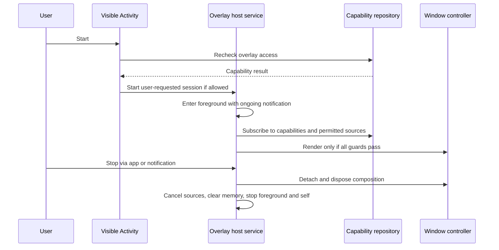

# 06 — Lifecycle and failure handling

Status: proposed · Owner: Android Platform

## Starting and stopping

No boot receiver or automatic post-kill restart in MVP. Use non-sticky service behavior as the baseline; verify actual OEM behavior. User-initiated Stop is authoritative. A listener rebind is distinct from starting an overlay session and cannot re-enable a stopped session.

## Failure matrix

| Trigger | Immediate response | Recovery | Evidence |
| --- | --- | --- | --- |
| Overlay permission revoked | Invalidate generation; detach; stop host | User regrants and explicitly starts | Revocation while expanded |
| Listener disconnected/revoked | Clear source data and action registry | Reconnect snapshot only after OS connection callback; manual settings guidance if needed | Disconnect with queued updates |
| Media session destroyed | Remove controller and candidate | Another valid session may be selected | Two players + terminated session |
| Lock or screen off | Detach and clear sensitive content | Refresh eligible snapshots after unlock if active session survives | Lock during action/animation |
| Process killed | OS removes window; runtime state lost | Reopen app, recheck capabilities, explicitly Start | Process death distinct from force-stop |
| User force-stops app | Remain stopped | User launches app | No alarms/jobs revive it |
| Rotation/fold/display change | Invalidate bounds before layout update | Recompute safe geometry; detach if no valid bounds | Cutout and fold transitions |
| Window add/update throws | Clear attachment marker, release view, report enum code | Bounded retry only when active and capability valid; otherwise stopped UI | Inject failure |
| Notification storm | Coalesce, bound memory, preserve controls | Reconcile source snapshot after pressure eases | Burst test |
| Corrupt preference data | Use validated safe defaults | Offer explicit reset; record generic failure | Corruption fixture |
| OEM terminates host | Mark stopped on next app observation | Explain supported manual restart | Physical-device endurance run |
| Source action canceled | No retry loop or reconstructed action | Explain action unavailable; refresh source state | Expired PendingIntent |

## Recovery discipline

Reconnect callbacks must not resurrect stale data. Increment source epoch at disconnect/reconnect and drop obsolete events. Subscribe to callbacks and perform snapshot reconciliation through one adapter-owned serialization boundary so a removal racing with a snapshot cannot reappear.

Permission checks happen on Activity resume, source reconnection, before attaching a window, and immediately before dispatch. Where Android offers no push callback, revalidation occurs at these safe entry points; any API exception revokes the local capability immediately. Never use periodic permission polling to keep the process alive.

Renderer attachment is idempotent: `attach`, `update`, and `detach` may be repeated without duplicate windows or leaked compositions. Callback and timer jobs must be canceled during Stop. Include a session generation in scheduled deadlines to prevent an old timer changing a new session.

## Service notifications and jobs

Provide a clear ongoing notification with Pause and Stop and an appropriate low-importance channel. Do not attempt to hide mandatory foreground-service indicators. If posting permission is denied, explain the system's alternate foreground-service visibility and preserve in-app controls. See [notification permission behavior](https://developer.android.com/develop/ui/compose/notifications/notification-permission).

WorkManager is not a replacement for the real-time overlay session. MVP has no periodic job, wake lock, exact alarm, automatic battery exemption request, or backend heartbeat.
