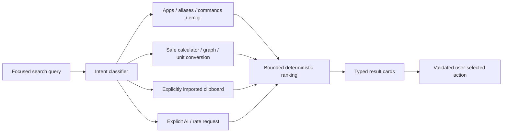

# 11 — Command palette architecture

Status: accepted direction for implementation kickoff; platform/provider details remain proposed.

## Search pipeline

A Kotlin JVM domain module owns pure search matching, arithmetic parsing, graph sampling, offline conversions and activity selection. Android adapters own PackageManager, ClipboardManager, media and torch access. Compose renders typed cards. Provider results use stable IDs and query generations so an old response cannot replace a newer query. Cancel work when a query changes; cap query length, result count, evaluation depth and sample count.

## Provider contracts

`SearchProvider.search(query, generation)` returns typed results: app, command, calculation, graph, conversion, emoji, clip, AI answer or rate card. `ActionDescriptor` describes a supported action; platform dispatch rechecks capabilities. No provider returns executable scripts, arbitrary shell code or trusted HTML. Graph evaluation uses a parser with an allowlist of functions, not JavaScript eval or an embedded WebView.

First arithmetic grammar: decimal numbers, parentheses, `+ - * / ^`, unary signs, constants `pi`/`e`, variable `x`, and sin/cos/tan/sqrt/abs/floor/ceil/ln/log. Trigonometric arguments are radians. Reject invalid/nonfinite results; preserve gaps at graph discontinuities. Unit conversions include length, mass and temperature with dimension checking. Fiat/crypto values require a separately configured, timestamped provider.

## Apps and settings

Query launchable activities with a narrow MAIN/LAUNCHER manifest query. Stable identity is the component name, not the label. Recheck resolution on launch; handle uninstall and disabled components gracefully. Local favorites, aliases, visibility and priority live in app-private preferences. Recent means launches performed through this app, not usage history inferred from other apps.

Initial shell uses the normal app Activity. Future entry points: a user-pinned shortcut, Quick Settings tile or explicit island action. Global hotkeys and unrestricted app shortcuts are not assumed. Full `LauncherApps` shortcut access requires a capability experiment and possibly the default launcher role.

## Clipboard data

Read only after an explicit user action while Activity has focus. Import text only; do not dereference URI/path clips. Reject OS-marked sensitive clips. Bound to 20 clips and 4096 characters per clip; deduplicate; memory-only retention; clear on lock/process death and explicit clear. Pause prevents further imports; search/copy/delete affect only imported clips. Never send clipboard text to AI unless the user explicitly selects it and chooses Send.

## Network features

AI, live rates and lyrics are optional providers. Offline functions work without them. Current scaffold has no INTERNET permission or provider keys. Adding a provider requires ADR-005 implementation details: allowlisted HTTPS destinations, query-specific consent, credential storage, cancellation/timeouts, bounded responses and redacted diagnostics. Never embed server API secrets in the APK. A hosted proxy or user-provided credentials is a decision to resolve before integration.

Rate cards show provider, pair, quote timestamp and freshness, with history only when supplied. AI cards show real provider/model and request state; generated text is untrusted content and cannot dispatch commands. Lyrics require an authorized data source; ordinary media sessions do not guarantee lyrics.
